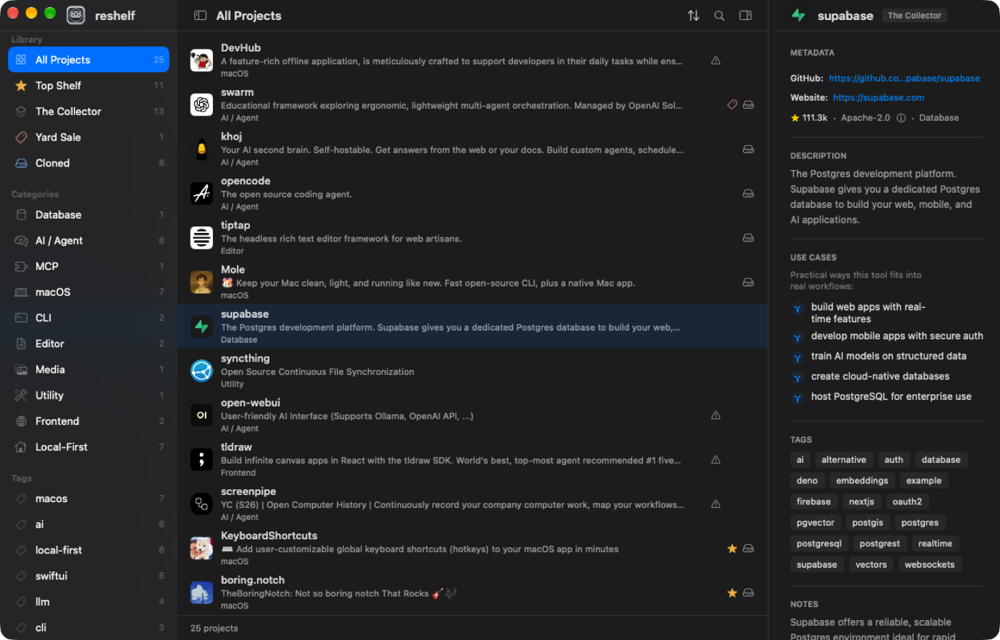
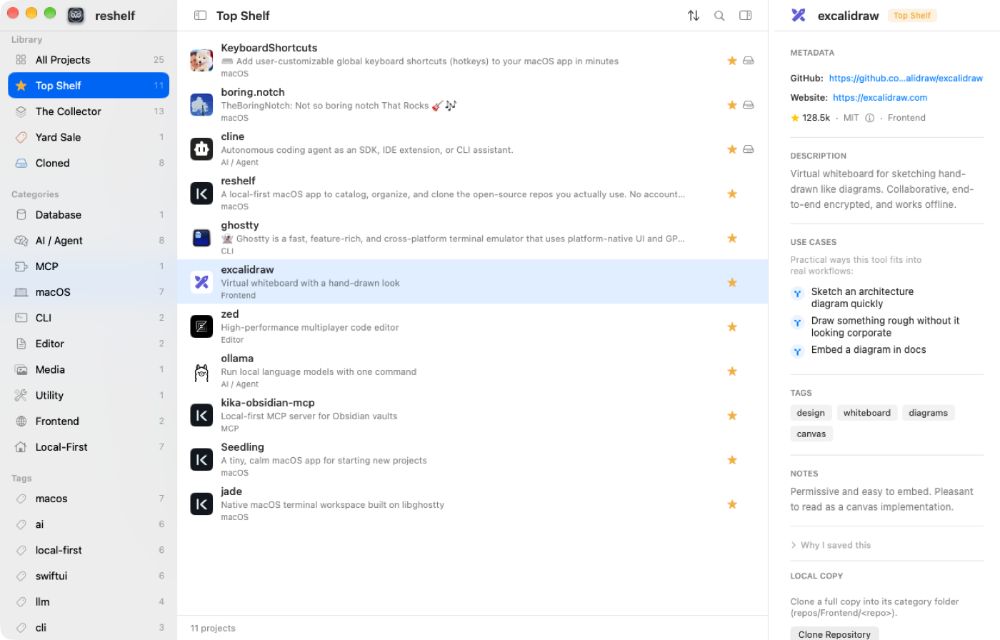
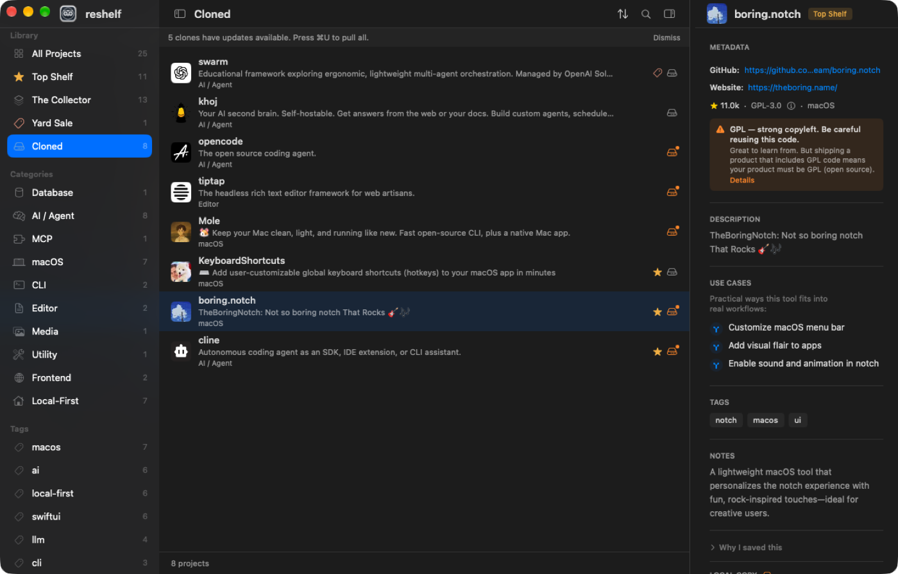
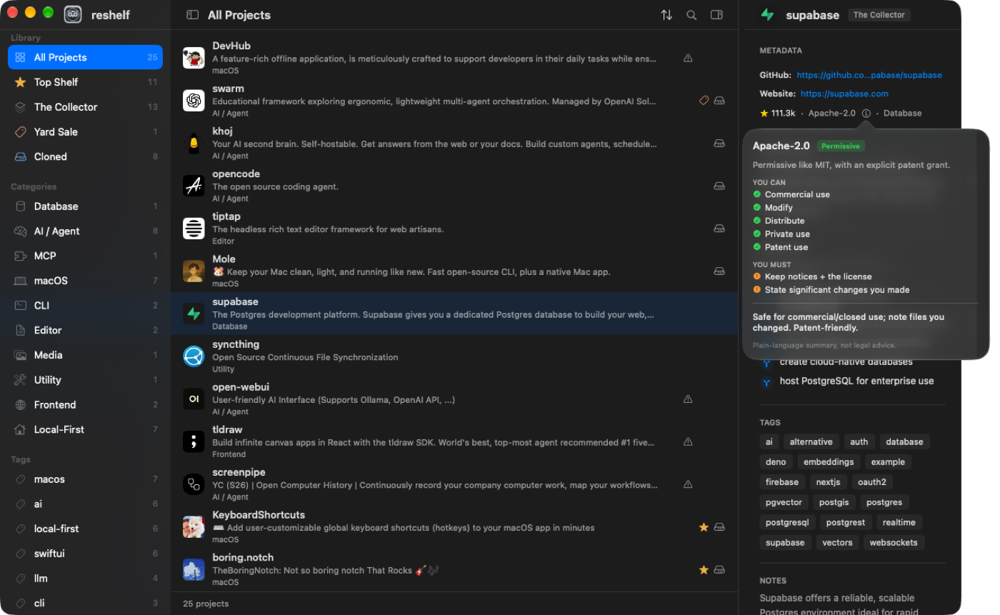

<p align="center">
  
</p>

<h1 align="center">reshelf</h1>

<p align="center">
  
  
  
  
  
  
  <a href="https://github.com/aka-kika/reshelf/releases/latest"></a>
  
</p>

<p align="center">
  <a href="https://aka-kika.github.io/reshelf/">aka-kika.github.io/reshelf</a> · <a href="https://github.com/aka-kika/reshelf/releases/latest">latest release</a>
</p>

A local-first macOS app for cataloging the open-source GitHub repos you save. Paste a GitHub link and reshelf fetches it, sorts it into a category and puts it on a shelf; clone the ones you use into one tidy folder, and it tells you when a clone has updates to pull. No account and no cloud: your catalog and clones live on your Mac.

<p align="center">
  
</p>

- macOS 14 or later, one universal app for Apple Silicon and Intel, signed and notarized.
- Swift, SwiftUI and SwiftData, with GRDB (SQLite) for clone and metadata records and Sparkle for signed updates.
- AI only on the device (Apple Intelligence), never a cloud provider.
- A Claude Code skill lets your coding agents read the repos you saved.

## In one minute

1. Open reshelf: a **sidebar**, a **project list** and an **inspector**.
2. Press **⌘K** and paste a GitHub URL. Quick Capture opens; **Enter** fetches, **Enter** again saves (no mouse needed).
3. Put it on a shelf (**⌘T** Top Shelf, **⌘Y** Yard Sale), or filter the sidebar by category, folder or **Cloned**.
4. Right-click a repo → **Clone Repository**. The inspector shows **up to date** or **updates available**, with a one-click **Pull**.

## How you run it

Download `reshelf-<version>.dmg` from [Releases](https://github.com/aka-kika/reshelf/releases/latest), open it and drag **reshelf** to Applications. It is signed and notarized, so it opens with no Gatekeeper warning, and it updates itself through Sparkle (**Check for Updates**). Needs macOS 14 or later; one universal app for Apple Silicon and Intel.

To build it yourself you need Xcode 16 or later (Swift 6). Open `OpenSourceShelf.xcodeproj`, pick the scheme **OpenSource Shelf** and press ⌘R, or from Terminal:

```bash
bash build.sh          # Debug build into .build/reshelf.app
xcodebuild -project OpenSourceShelf.xcodeproj -scheme "OpenSource Shelf" -destination 'platform=macOS' build
```

The first build fetches **GRDB** through Swift Package Manager. The Dock and menu bar say **reshelf**; the Xcode project, scheme and module keep the old name `OpenSourceShelf`.

## Paste a link, it sorts itself

Copy a GitHub link and press **⌘V** anywhere in the window (or paste into **⌘K** or **⌘N**). reshelf fetches the repo's details and puts it in a category (Database, AI / Agent, macOS and so on) without any AI. If it is already on your shelf, you get an "Already on your shelf" card and Return jumps to it; **Remove Duplicate Repos** cleans up older doubles.

On Macs with Apple Intelligence, **Capture Assist** can fill in use cases, a note and tags right after you save, and a one-click backfill fills entries that have none. It runs on the device, needs no key, and never overwrites what you typed (Settings → Capture → Capture Assist).

## Shelves, folders and filters

- **Three shelves:** **Top Shelf** for keepers, **The Collector** (the default) and **Yard Sale** for maybe or let go. Move a repo with **⌘T**, **⌘Y** or **⌘⇧G**.
- **Folders for a project:** clone thirty repos for one project and group them (right-click → **Folder**). Folders are separate from categories (what a repo *is*) and shelves (how much you value it). Deleting a folder only ungroups.
- **Many at once:** **⌘-click** rows (or **⇧-click** a range), then move them to a shelf, add them to a folder, or remove their clones together.
- **Browse by anything:** shelf, live category list, folders, tags (most used or recently added) or Cloned. Sort by Recently Added, Name, Most Stars or Last Updated, and filter any list by language or **UI Only**.
- **The UI mark:** mark the repos whose look you like (right-click, the brush).
- **Your window:** light or dark, following macOS or set in Settings. Drag the sidebar and inspector edges to resize, and show, hide or drag-reorder the inspector's sections in Settings.

<p align="center">
  
</p>

| Shortcut | Action |
|----------|--------|
| ⌘K | Command palette: search, or paste a GitHub URL |
| ⌘N | Quick Capture (GitHub URL) |
| ⌘T / ⌘Y / ⌘⇧G | Move the selected repo to Top Shelf / Yard Sale / The Collector |
| ⌘⇧U | Check clones for updates |
| ⌘⇧E | Export the catalog as JSON |
| ⌘S / ⌘I | Show or hide the sidebar / inspector |

## Clones in one tidy folder

Right-click a repo → **Clone Repository**. Full clones land at `~/reshelf/repos/<Category>/<repo>`, so you can point an AI agent at one category. It works without `git-lfs`; cloning uses git from Apple's Command Line Tools (run `xcode-select --install` once if they are missing).

A read-only `git ls-remote` tells you which clones are behind. **Pull** updates one, **Check Clones for Updates** (⌘⇧U) sweeps them all, and right-click a folder → **Pull Repos** updates one project's clones. Remove Local Clone moves a clone to the Trash.

<p align="center">
  
</p>

## Licenses in plain words

An ⓘ next to any license explains in plain language what you can do and what you must do, and whether it is safe to reuse in something closed-source, with a caution for copyleft and source-available licenses.

<p align="center">
  
</p>

## See what fits your own projects

Press the **+** next to **My Repos** and tick your GitHub repos. Click one and the list shows the repos on your shelf that fit it, best first, each with a one-line **Why it fits** written on your Mac by Apple Intelligence. Fits run only when you ask (adding a repo, **New Fits**, **Analyze All Fits**), never in the background. **Settings → Fits** sets how many, same language only, recently updated, and hiding GPL, AGPL or archived repos.

When an agent borrows code from a shelf repo for one of your projects, the reshelf skill thanks the author in that project's `ACKNOWLEDGEMENTS.md` and the inspector shows "Reshelfed in <project>". The **Reshelfed** row in the sidebar counts them.

## Point your agents at your shelf

Your clones sit in a predictable layout and your catalog exports as plain JSON, so a coding agent can search the real source you saved instead of guessing from old docs.

reshelf ships a **Claude Code skill** in [`extras/reshelf-skill`](extras/reshelf-skill). **Settings → Library → Agent Skill → Install reshelf Skill** copies it to `~/.claude/skills/reshelf`; click it again after updating reshelf. The skill looks at your **Top Shelf** first, then **The Collector** (never the Yard Sale), reads the source of cloned repos or the README of the others, recommends the best fit with a license warning when needed, and clones a pick only after you say yes ([README](extras/reshelf-skill/README.md)).

Built something that talks to reshelf, like a script or another integration? Open an issue or a pull request with a link, or add it under `extras/`.

## Privacy

- **GitHub** is asked only about the repos you save: when you capture or import one (its details and its owner's avatar as the icon), when you pull a clone or use Shelf → Refresh Info, and for update checks on clones. Missing icons are fetched again at launch.
- **My Repos and fits** read your repo list and READMEs, and the READMEs of the best matches, only when you add your repos or run fits. A GitHub token (Settings → Capture, kept in the Keychain) is optional and adds your private repos.
- **AI** runs on the device only; there is no cloud provider to choose.
- **Updates:** Sparkle fetches a static appcast from GitHub Pages. Every update is EdDSA-signed and notarized; automatic checks can be turned off in Settings.
- No sign-in, no telemetry. Credentials, when used, live in the macOS Keychain.

| What | Where |
|------|-------|
| Catalog (projects, folders, settings) | `~/reshelf/catalog.store` (SwiftData, its own store) |
| Automatic JSON backups | `~/reshelf/backups/` (the last 30 routine ones and the last 40 taken before a big change) |
| Local clones | `~/reshelf/repos/<Category>/<repo>` (full clones, by category) |
| Clone and metadata records | `~/reshelf/database/opensource-shelf.sqlite` (GRDB) |

If the catalog ever comes up empty, reshelf restores it from the newest backup (not when you emptied the shelf yourself). Restore, JSON import and export are in the File menu.

## FAQ

**How is this different from GitHub stars or browser bookmarks?**
Stars are a flat, growing pile on GitHub's servers; bookmarks disappear into the browser. In reshelf every repo is put in a category, on a shelf by how much you value it, and in folders by project, so "what did I save for X, and which one should I use?" takes seconds. And when you are ready to use a repo, reshelf clones it into an organized local library and tells you when it is behind.

**Is it free?**
Yes, free and open source under the MIT license.

**Why did you build it?**
I kept finding great open-source repos in browser tabs, GitHub stars and links I'd never open again, and losing them. I wanted a calm, local place for the ones that matter to me: decide quickly whether something is a keeper, a maybe or a let-go, and pull its code close when I'm ready to learn from it. I use it every day. (Kika)

## Docs

| File | What is in it |
|------|---------|
| [features.md](features.md) | What works today |
| [goals.md](goals.md) | Why the app exists, and its principles |
| [v2.0-roadmap.md](v2.0-roadmap.md) | What is next: a read-only GitHub login for better recommendations |
| [future-features.md](future-features.md) | Ideas not built yet |
| [todo.md](todo.md) | Working checklist and recent history |
| [CHANGELOG.md](CHANGELOG.md) | Every change, version by version |
| [AGENTS.md](AGENTS.md) | Architecture and rules for coding agents |
| [SECURITY.md](SECURITY.md) | How to report a security problem |
| [site/](site) | The landing page at [aka-kika.github.io/reshelf](https://aka-kika.github.io/reshelf/), deployed to the `gh-pages` branch, which also hosts the Sparkle appcast |

## Release

Releases are signed, notarized universal DMGs on the [Releases](https://github.com/aka-kika/reshelf/releases) page; notes per version are in [CHANGELOG.md](CHANGELOG.md) and [docs/release-notes/](docs/release-notes/). The newest is 1.17.1.

## Contributing

Bug reports, fixes, features, docs, design feedback and integrations are all welcome. Start with [CONTRIBUTING.md](CONTRIBUTING.md) for build steps and the one gotcha (new Swift files must be registered in `project.pbxproj`). Use the issue templates.

## License

[MIT](LICENSE) © reshelf contributors.

Made by **Kika** ([aka-kika](https://github.com/aka-kika), [akakika.com](https://akakika.com)).
